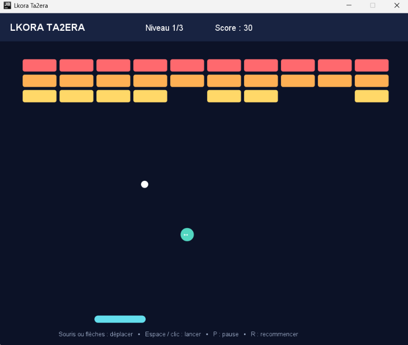

# Lkora Ta2era

Un casse-briques en Java Swing : détruis toutes les briques pour réussir les trois niveaux ! Les briques marquées **2** demandent deux coups.

### Une partie en cours

## Télécharger

Les archives Windows et macOS sont disponibles dans la section **Releases** du dépôt GitHub. Elles comprennent Java : aucune installation séparée de Java n'est nécessaire. La version macOS est destinée aux Mac Apple Silicon (ARM64). Sur macOS, l'application non signée peut nécessiter une autorisation dans les réglages de sécurité.

## Lancer dans IntelliJ IDEA

1. Ouvre le dossier `LkoraTa2era` dans IntelliJ IDEA.
2. Configure un JDK dans **File → Project Structure → Project** si nécessaire.
3. Ouvre `src/LkoraTa2era.java` et lance sa méthode `main` avec le bouton vert.

En ligne de commande, avec un JDK disponible : `javac -encoding UTF-8 -d out src/*.java`, puis `java -cp out LkoraTa2era`.

## Commandes et règles

- Souris ou flèches gauche/droite : déplacer la barre.
- Espace ou clic : lancer la balle ; après une partie, recommencer.
- P : pause/reprise. R : recommencer à tout moment.
- La partie est perdue dès qu'une balle tombe, même s'il reste d'autres balles.
- Attrape les bonus qui tombent : **x2** double les balles (maximum 8) et **↔** agrandit temporairement la barre.

Le projet utilise notamment `JFrame`, `JPanel`, `paintComponent`, les événements, un `Timer`, les collections et les collisions avec `Rectangle`.

## Licence

Copyright © 2026 Taha Amine ER-RAFIY. Distribué sous [licence MIT](LICENSE).
