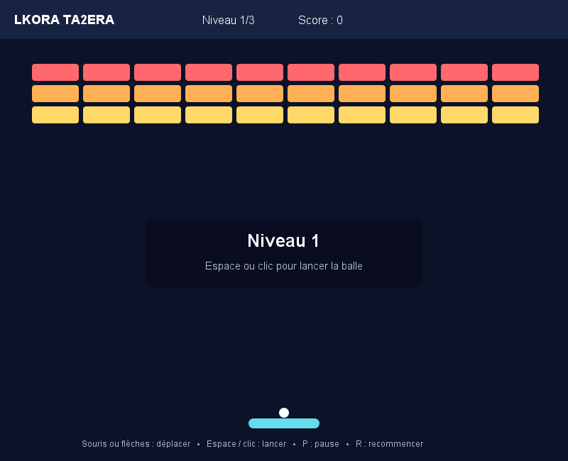

# LKORA TA2ERA

Jeu de casse-briques en Java Swing avec trois niveaux et des bonus. Les briques marquées **2** demandent deux coups.

## Aperçus




## Installer et lancer

### Avec les versions GitHub

1. Ouvrir la page [Releases](https://github.com/Doomed2Fail/LKORA-TA2ERA/releases/latest) et télécharger l’archive correspondant à son ordinateur.
2. Décompresser l’archive ZIP.
3. Sous Windows, ouvrir le dossier décompressé et lancer `LkoraTa2era.exe`. Sous macOS, ouvrir `LkoraTa2era.app`.

Ces versions comprennent Java. La version macOS est prévue pour les Mac Apple Silicon ; l’application non signée peut nécessiter une autorisation dans les réglages de sécurité macOS.

### Avec le JAR fourni séparément

Installer Java 8 ou une version ultérieure, puis ouvrir un terminal dans le dossier contenant `LKORA-TA2ERA.jar` et lancer :

```sh
java -jar LKORA-TA2ERA.jar
```

Un double-clic peut fonctionner si les fichiers JAR sont associés à Java. Vérifier l’installation avec `java -version` si la commande n’est pas reconnue.

### Depuis le code source

Dans IntelliJ IDEA, ouvrir le dépôt, configurer un JDK et lancer la méthode `main` de `src/LkoraTa2era.java`.

## Commandes

- Souris ou flèches : déplacer la barre.
- Espace ou clic : lancer la balle ou recommencer après une partie.
- P : pause et reprise ; R : recommencer.
- Une balle qui tombe termine la partie. Le bonus **x2** multiplie les balles et **↔** agrandit temporairement la barre.

## Licence

Copyright © 2026 Taha Amine ER-RAFIY — [licence MIT](LICENSE).
